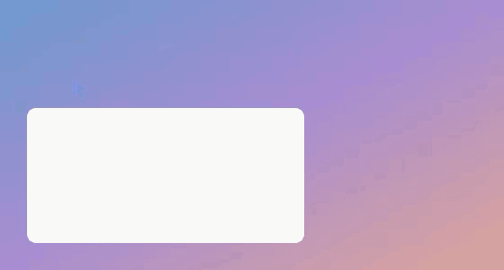

# dsh-mac-computer-use

**给 DSH 的 Mac 桌面操作能力（computer use）。视觉优先，不依赖无障碍权限。**

> 以前叫 `dsh-cu`，2026-10-18 改名。旧地址会自动跳到这里；底层的命令行引擎仍叫 `dsh-cu`。
> 和别人家的 [dsh-computer-use](https://github.com/988hj7tczd-oss/dsh-computer-use) 不是一个东西：那个靠无障碍树（cua-driver），这个靠截图。



*光标按 Codex 的 `scoot` 模型实现：移动时沿运动方向拉伸、点击时原地均匀缩小（支点在箭头尖端，所以瞄准点纹丝不动）。*

11 个 `desktop_*` 工具 + 一个自包含的 Swift 命令行 + 一套 Codex 风格的光标动效。

```
desktop_windows    desktop_observe    desktop_screenshot   desktop_find_text
desktop_click      desktop_type       desktop_key          desktop_apps
desktop_launch     desktop_scroll     desktop_drag
```

---

## 为什么又造一个

DSH 上已有的 computer use 插件（`dsh-computer-use`、`dsh-mac-cua` 等）大多依赖 **macOS 无障碍树（AX）**。
我们实测过：**锁屏时 AX 对所有应用都返回 0 个 AXWindow**，解锁后立刻恢复正常 —— 这是 macOS 的行为，
不是驱动的 bug（[详细记录](docs/locked-session-and-ax.md)）。另外第三方二进制在某些环境下拿不到 AXWindow。

**Codex 那种 computer use 走的是视觉路线**：截图 → 模型看 → 按坐标操作。这条路不碰 AX，
所以在 AX 不灵的环境下照样能用。这个仓库就是那条路，外加：

| | |
|---|---|
| **OCR 找文字** | 用 macOS 自带的 Vision 框架，本地跑。`desktop_click(text="登录")` 直接按文字点 |
| **元素编号** | `desktop_observe` 把可点元素在截图上编号，模型说"点第 7 个"就行 |
| **Codex 风格光标** | 从 Codex Computer Use 的资源里描出形状，配了弹簧动效（scoot） |
| **空闲自退** | 光标浮层 60 秒没动静自己走，不留常驻进程 |
| **单文件 Swift** | 零依赖，好审计 |

---

## 安装

```bash
git clone https://github.com/OrderG-X/dsh-mac-computer-use.git
cd dsh-mac-computer-use
./install.sh
```

需要 macOS + Xcode Command Line Tools（`xcode-select --install`）。
光标素材用 Pillow 生成（`python3 -m pip install pillow numpy`），没有也能跑，只是光标退化成简单箭头。

装完去 DSH 的**插件页**，把这个仓库地址加进去，然后**重启 DSH**。

装好后插件页里叫「**Mac 桌面操作**」。点进去是设置页：能不能用、看得到几个窗口，命令行引擎、屏幕录制权限、辅助功能权限、光标浮层逐项打勾，缺哪个就给哪个的按钮（复制安装命令 / 打开系统设置）；还有「屏幕上显示操作光标」开关。

---

## 用起来是什么样

```
你：帮我看看屏幕上有什么
→ desktop_windows      拿到窗口列表和坐标
→ desktop_screenshot   模型看到图

你：点那个「登录」按钮
→ desktop_click(text="登录")   OCR 找到它 → 发事件过去（不动你的鼠标）

你：把计算器的 7+8 算一下
→ desktop_observe      截图 + 元素编号
→ desktop_click(index=5) 点第 5 个（"7"）
→ desktop_screenshot   再截一次确认
```

**推荐工作流是 `observe → click(index)`** —— 模型看图上的编号，比算坐标可靠得多。

---

## 底层

```
DSH 工具 (desktop_*)
      ↓ spawn
dsh-cu (Swift 单文件)
      ├── winlist   CGWindowListCopyWindowInfo   ← 窗口坐标，零权限
      ├── observe   AX 枚举可点元素 + 截图标注编号
      ├── shot      screencapture
      ├── find      Vision 框架 OCR              ← 找文字 → 可点坐标
      ├── clickat   CGEvent postToPid            ← 不移动真实鼠标、不抢前台
      ├── type/key  CGEvent                      ← 支持中文
      ├── scroll/drag  CGEvent
      └── launch    NSWorkspace（后台启动，不抢前台）
```

命令行也能单独用：

```bash
dsh-cu winlist                    # 列窗口
dsh-cu tree <pid>                 # AX 树（解锁状态下可用）
dsh-cu observe <pid>              # 截图 + 编号
dsh-cu find "登录"                 # OCR 找文字 → 坐标
dsh-cu clickat <pid> <x> <y>      # 点（默认不动真实鼠标）
dsh-cu type <pid> "你好"           # 输入
dsh-cu selftest                   # 全链路自检（见 tools/selftest.sh）
```

---

## 光标

`cursor/` 里是 Codex 风格的桌面光标浮层和网页页内光标：

| | 用在哪 | 样子 |
|---|---|---|
| `dsh-cursor-overlay` | 操作应用 | 蓝色实心箭头，**NSPanel 浮层**：不抢前台、点击穿透、永远置顶 |
| `in-page-cursor.js` | 操作浏览器 | 半透明蓝色，注入页面，**会出现在截图里** |

**动效**（照 Codex 的 `scoot` 参数名实现）：

- 移动时**沿运动方向拉伸**（峰值 1.30）+ 快速移动时轻微模糊 + 朝运动方向侧倾
- 点击时**原地均匀缩小**到 0.88（支点在箭头尖端，所以瞄准点纹丝不动）
- 静止时轻微呼吸 + 24 帧流动渐变

实测一次 1100px 的移动：

```
vel=9902  stretch=1.300  blur=1.00  tilt=0.129   ← 起飞
vel=1425  stretch=1.164  blur=0.44               ← 减速
vel=0     stretch=1.000  blur=0.00               ← 落位收回
```

---

## 已知限制

- **锁屏时**：截图只有壁纸、窗口不渲染、AX 读不到窗口 —— 这是 macOS 的行为，不是工具的问题
- `desktop_click` 默认投递给目标进程（`postToPid`）。个别应用不响应投递事件，加 `global: true` 走系统事件兜底（会移动真实鼠标）
- **桌面点击驱动不了 Chrome** —— Chrome 不理会投递的合成事件。操作浏览器请用 CDP 类工具（比如 [dsh-chrome-bridge](https://github.com/OrderG-X/dsh-chrome-bridge)）
- 需要**屏幕录制**权限（`screencapture` 用）

---

## Field notes

[docs/locked-session-and-ax.md](docs/locked-session-and-ax.md) —— 锁屏会让 AX 全废这件事，
以及为什么它看起来跟驱动 bug 一模一样。这个坑花了一整天才确认。

---

## License

MIT。`tools/dsh-cu.swift` 是自包含单文件，想改直接改。

---

## 关于光标形状

仓库里的光标是**程序绘制的**（`cursor/make-cursor.py`），形状是经典 macOS 箭头几何，
配色是蓝色渐变 —— 不包含任何第三方的素材文件。

我们自己那套更"Codex 味"的形状，是从 Codex Computer Use 的安装包里描出来的（学习用途），
**没有放进这个仓库**。你要是本地装了 Codex，可以自己提取了对比着玩。
